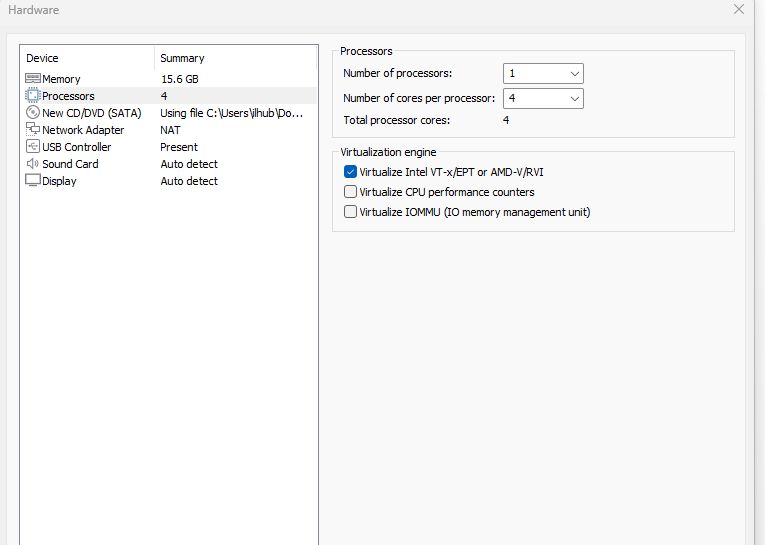
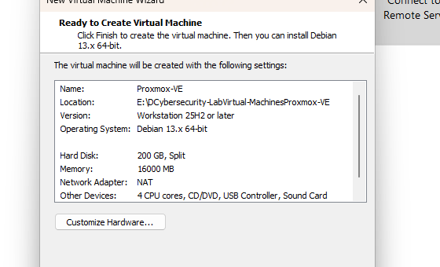
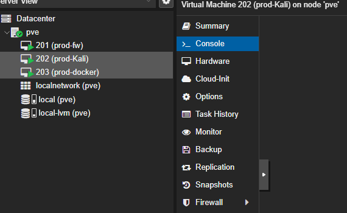
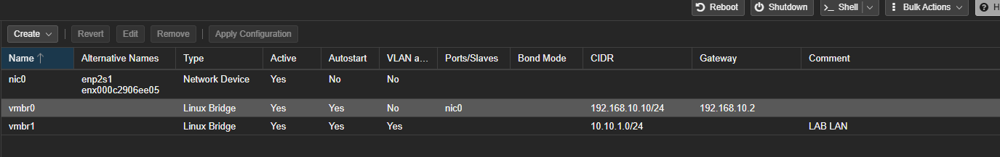
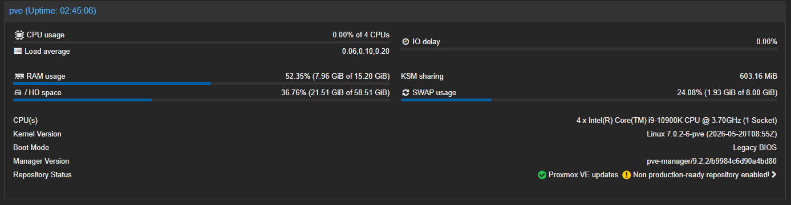
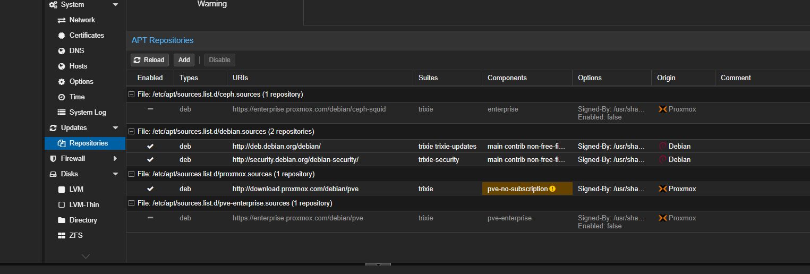

# 01 — Network Infrastructure and Virtualization

## Objective

Create a usable nested virtualization environment for a cybersecurity home lab, including management connectivity, a dedicated internal virtual bridge, and multiple cybersecurity virtual machines.

## Environment

| Layer | Implementation |
|---|---|
| Physical host | Windows PC, Intel Core i9-10900K, 10 cores / 20 threads, 32 GB RAM |
| Desktop virtualization | VMware Workstation Pro 26H1 |
| Nested hypervisor | Proxmox VE 9.2.2 (Debian-based) |
| Proxmox virtual CPU | 4 vCPUs (1 socket, 4 cores) |
| Proxmox virtual RAM | 16,000 MB configured (15.20 GiB displayed in Proxmox) |
| Proxmox virtual disk | 200 GB virtual disk, split VMDK; guest root filesystem displays a smaller allocation |
| Proxmox virtualization option | Intel VT-x/EPT pass-through enabled |
| VMware virtual network | NAT |
| Proxmox management address | `192.168.10.10/24`, gateway `192.168.10.2` |

### Evidence: VMware configuration

## Proxmox virtual machine inventory

| VM ID | VM name | Function | Observed evidence |
|---|---|---|---|
| 201 | `prod-fw` | pfSense firewall | WAN/LAN and VLAN configuration shown in pfSense console and web UI |
| 202 | `prod-Kali` | Kali Linux | Kali 2026.3 and `eth0` interface shown |
| 203 | `prod-docker` | Ubuntu Server / Docker / Portainer | Ubuntu 26.04.1 LTS, running Portainer container shown |

## Network bridges

| Name | Type | Address shown in Proxmox | VLAN aware | Attached port | Role |
|---|---|---|---|---|---|
| `vmbr0` | Linux Bridge | `192.168.10.10/24` | No | `nic0` | Management / upstream VMware NAT |
| `vmbr1` | Linux Bridge | `10.10.1.0/24` | Yes | None | Internal lab network / tagged VLAN support |

**Address review:** `10.10.1.0/24` is the network address of its `/24` subnet. That is not a normal usable host address. This setting requires review; it is not presented as a validated management IP. The separate pfSense LAN address `10.10.1.254/24` is confirmed in its console.

## Proxmox host verification

The Proxmox Summary page confirms Proxmox VE 9.2.2 with four virtual CPUs. At the time of capture, memory usage was approximately 7.96 GiB out of 15.20 GiB and swap usage was approximately 1.93 GiB out of 8 GiB. These are observations, not sustained benchmark measurements.

## Troubleshooting performed

### Hardware virtualization initially disabled

The Windows host initially reported virtualization as disabled. I enabled Intel hardware virtualization in BIOS and selected VMware's **Virtualize Intel VT-x/EPT** option to support nested VMs.

### Virtual disk consistency warning

At the initial startup of the new Proxmox VM, VMware flagged a virtual disk consistency error. I used its repair option, after which the Proxmox installer successfully booted. A long-term disk health assessment was not conducted.

### Updates failed with `401 Unauthorized`

Proxmox's preconfigured Enterprise and Ceph Enterprise update repositories required a paid subscription. `apt update` returned HTTP 401 errors for those sources. I disabled both Enterprise sources, enabled `pve-no-subscription`, and verified that the package update refresh reported `TASK OK`.

## Outcome and next validation

A running nested Proxmox environment is documented, with three named cybersecurity VMs and two Linux bridges. Future validation will confirm actual VM network adapters, VLAN tags, traffic isolation, host resource headroom, and address correctness.

**Skills:** VMware Workstation, nested virtualization, Proxmox administration, Linux bridges, static management addressing, troubleshooting, package repositories.
