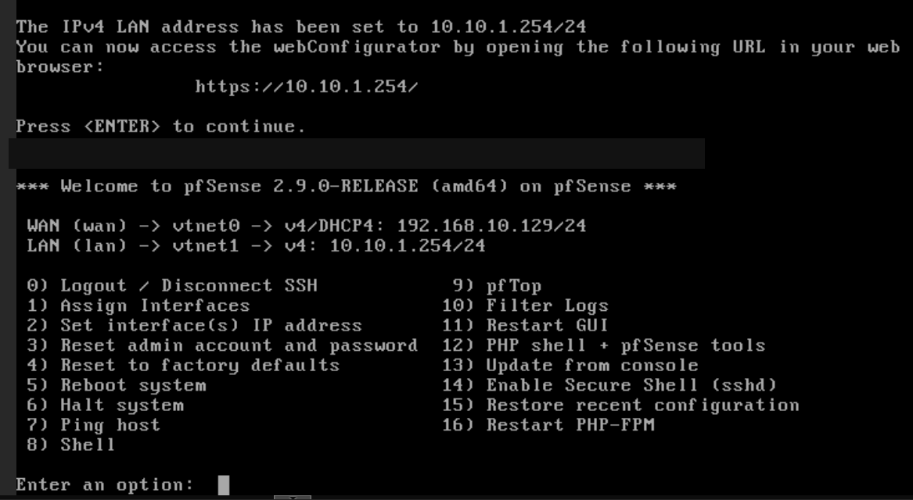
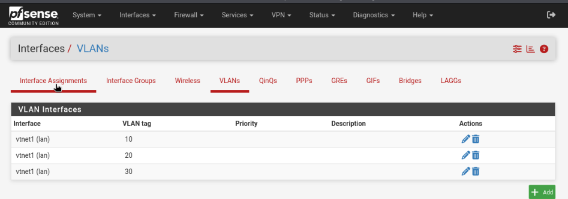
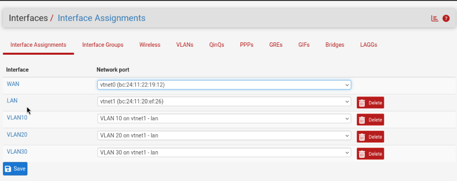
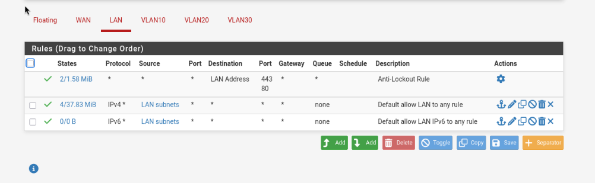
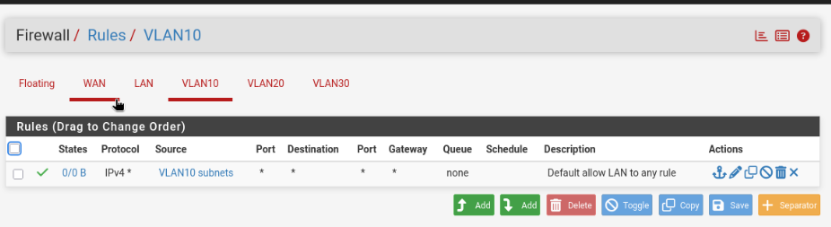
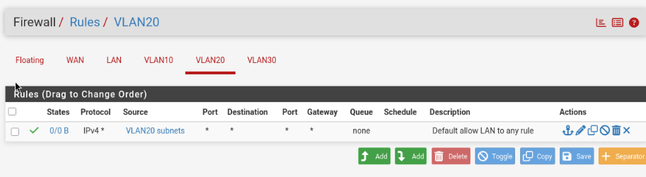
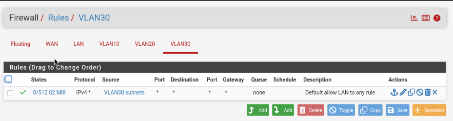

# 02 — pfSense Firewall and VLAN Configuration

## Objective

Deploy pfSense Community Edition as the lab firewall and prepare separate internal VLAN interfaces for later firewall-policy testing.

## Firewall deployment

| Property | Value observed |
|---|---|
| Virtual machine | VM 201, `prod-fw` |
| Platform | Proxmox VE 9.2.2 |
| Firewall OS | pfSense CE 2.9.0 |
| WAN | `vtnet0`, IPv4 DHCP `192.168.10.129/24` |
| LAN | `vtnet1`, static IPv4 `10.10.1.254/24` |
| LAN administration | HTTPS web configurator at `https://10.10.1.254` |

## VLAN creation and assignments

The parent interface `vtnet1` has three VLANs configured and each VLAN is assigned as a pfSense interface.

| VLAN tag | Parent device | pfSense assignment | Subnet / gateway |
|---|---|---|---|
| 10 | `vtnet1` | `VLAN10` | Not captured; needs verification |
| 20 | `vtnet1` | `VLAN20` | Not captured; needs verification |
| 30 | `vtnet1` | `VLAN30` | Not captured; needs verification |

## Firewall rules observed

The LAN and each VLAN rule page were reviewed and recorded. Rules in these screenshots permit traffic; they should not be described as restrictive segmentation policies.

| Interface | Rule(s) observed | What the rule permits |
|---|---|---|
| LAN | Anti-lockout rule and default allow IPv4/IPv6 | Management to the LAN interface plus outbound traffic from the LAN according to each rule |
| VLAN10 | IPv4 allow; source `VLAN10 subnets`; destination any | IPv4 packets from VLAN10 subject to routing/other rules |
| VLAN20 | IPv4 allow; source `VLAN20 subnets`; destination any | IPv4 packets from VLAN20 subject to routing/other rules |
| VLAN30 | IPv4 allow; source `VLAN30 subnets`; destination any | IPv4 packets from VLAN30 subject to routing/other rules |

The VLAN10 and VLAN20 rule counters showed 0 B in their captured views. VLAN30's allow rule displayed about 512.02 MiB. These are rule counters at the time of the screenshots, not proof of an isolation or security test.

## Security analysis

- **Established:** pfSense runs with WAN/LAN interfaces; VLAN tags 10/20/30 exist; the corresponding interfaces have been assigned.
- **Not established:** IP settings for each VLAN, inter-VLAN blocking, firewall log review, egress restrictions, or isolation test results.
- **Security concern:** Existing IPv4 allow-to-any VLAN rules can permit communication toward other routed networks. VLAN interface creation by itself does not enforce isolation.
- **Credential concern:** An earlier screenshot warned that the pfSense admin account used the default password. The warning disappeared in a later screen, but password rotation was not independently verified. Confirm a strong unique password before sharing or exposing management access.

## Next validation tasks

- [ ] Confirm that the pfSense administrator password is no longer the default.
- [ ] Record each VLAN interface IP address and DHCP configuration.
- [ ] Identify which Proxmox VM NICs have VLAN tags and which bridge they use.
- [ ] Develop allow/deny policies for the intended trust zones.
- [ ] Test authorized connections between VLANs and record results.
- [ ] Confirm no unneeded management exposure from untrusted networks.

**Skills:** pfSense deployment, virtual interfaces, VLAN tagging, rule review, addressing, network segmentation fundamentals, security gap assessment.
