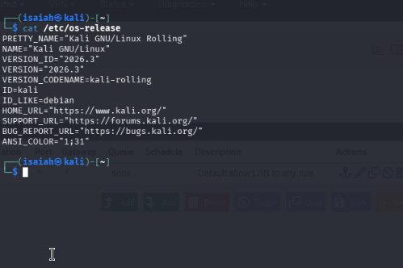
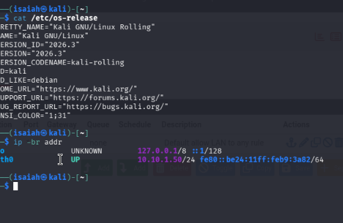

# 03 — Kali Linux Security Workstation

## Objective

Deploy a Kali Linux VM as the workstation for future authorized security testing and verification exercises.

## Observed system configuration

| Property | Value |
|---|---|
| Proxmox VM | 202, `prod-Kali` |
| Operating system | Kali GNU/Linux Rolling |
| Version | 2026.3 |
| Desktop selection during installation | Xfce |
| Installer tools selections | Kali Top 10 and default recommended tools |
| Network device | `eth0` |
| IPv4 address | `10.10.1.50/24` |
| Interface state | UP |

## Network placement

The `ip -br addr` output places Kali's `eth0` on `10.10.1.0/24`, the same subnet as the pfSense untagged LAN address `10.10.1.254/24`. This screenshot **does not** establish that Kali is attached to VLAN 10, 20, or 30.

## Work completed

Kali was installed in Proxmox with an Xfce desktop and security tool selections. The OS version and interface address were confirmed from the terminal. No offensive-security activity or vulnerability scan is claimed as complete in this stage.

## Planned validation

- [ ] Check default gateway and DNS resolution.
- [ ] Verify connectivity to approved lab targets only.
- [ ] Record tools used and their specific authorized test cases.
- [ ] Keep results, findings, mitigations, and permissions documented for future exercises.

**Skills:** Linux installation, command-line diagnostics, IPv4 addressing, virtualization, security-workstation administration.
