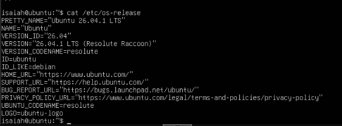
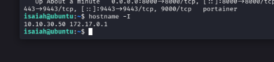

# 04 — Ubuntu Server Deployment

## Objective

Deploy an Ubuntu Server VM as the operating-system host for Docker Engine and Portainer.

## Observed system

| Property | Value |
|---|---|
| Proxmox VM | 203, `prod-docker` |
| OS | Ubuntu Server 26.04.1 LTS |
| Release codename | Resolute Raccoon |
| Server IP observed from `hostname -I` | `10.10.30.50` |
| Docker bridge IP observed | `172.17.0.1` |

The `10.10.30.50` address is consistent with the lab's VLAN30 naming, but the captured command alone does not verify a Proxmox NIC VLAN tag, a complete subnet mask, or firewall isolation.

## Work completed

Ubuntu Server was installed and a Docker Engine service was started. Docker commands were used for container deployment and service checks. Portainer was deployed as described in [05 — Docker and Portainer](../05-Docker-Portainer/README.md).

## Troubleshooting

Initial Docker commands without elevated privileges returned a Docker socket permission error. I used `sudo` for the relevant service and container-management commands. This does not, by itself, establish a permanent non-root Docker access configuration.

## Planned validation

- [ ] Confirm network gateway, DNS, interface CIDR and tagged network attachment.
- [ ] Document routine security updates and patch status.
- [ ] Confirm server-side firewall / service exposure settings.
- [ ] Document backup and recovery approach.

**Skills:** Linux system administration, service management, networking, permissions troubleshooting, server operations.
