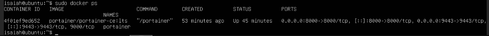
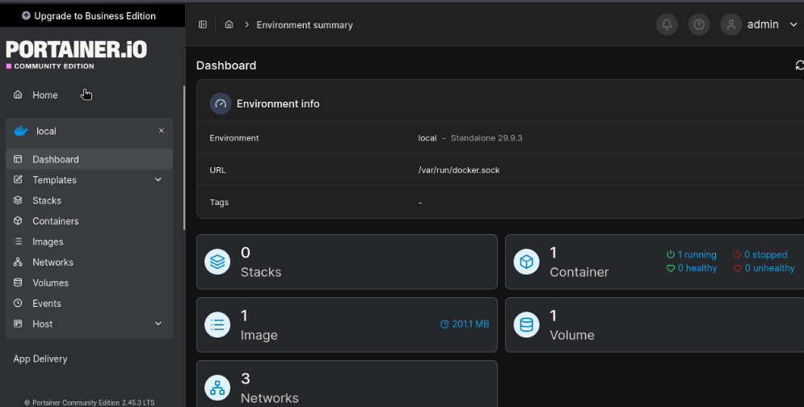

# 05 — Docker Engine and Portainer

## Objective

Install Docker Engine on Ubuntu Server and deploy Portainer CE to administer containers through a browser-based interface.

## Deployment evidence

| Setting | Observed result |
|---|---|
| Hosting VM | Ubuntu Server VM 203, `prod-docker` |
| Container image | `portainer/portainer-ce:lts` |
| Container name | `portainer` |
| HTTPS host port | `9443` |
| Additional published host port | `8000` (Portainer Edge Agent) |
| Local Docker connection | `/var/run/docker.sock` |
| Portainer Community Edition version | 2.45.3 LTS |
| Docker Engine version displayed | 29.9.3 |
| Environment | local / standalone |
| Dashboard totals at capture | 1 running container, 1 image, 1 volume, 3 networks, 0 stacks |

### Running container verification

The following read-only command was run on Ubuntu Server:

```bash
sudo docker ps
```

The output shows a running `portainer/portainer-ce:lts` container with published ports including `9443` and `8000`.



### Portainer management interface

Portainer is accessible from an authorized lab system at `https://10.10.30.50:9443`. The Portainer environment dashboard confirms connectivity to the local Docker socket and the observed workload inventory.



## Troubleshooting performed

**Docker socket access:** Non-root Docker management attempts failed with a permission error. Docker commands were successfully executed with `sudo`.

**HTTP vs HTTPS:** Opening port 9443 using plain HTTP produced an error stating that an HTTP request was sent to an HTTPS server. Correcting the URL to HTTPS resolved that issue.

**Portainer initial setup timeout:** The initial administrator setup expired. I restarted the container to reopen setup, then later accessed the dashboard successfully. No password or setup token is included in the repository.

## Security review / future tasks

- [ ] Confirm the Portainer administrator password is strong and unique.
- [ ] Restrict management access to approved lab networks.
- [ ] Determine whether published port 8000 is needed for this lab; remove exposure if not.
- [ ] Document host/container backups and patch schedule.
- [ ] Avoid storing Docker credentials or live API tokens in GitHub.

**Skills:** Docker deployment, persistent volumes, container lifecycle management, HTTPS service access, Portainer administration, permissions debugging.
