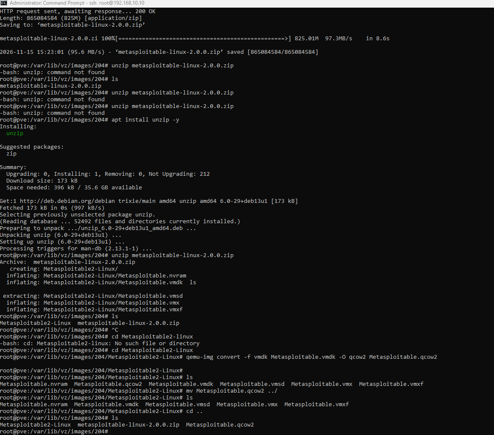
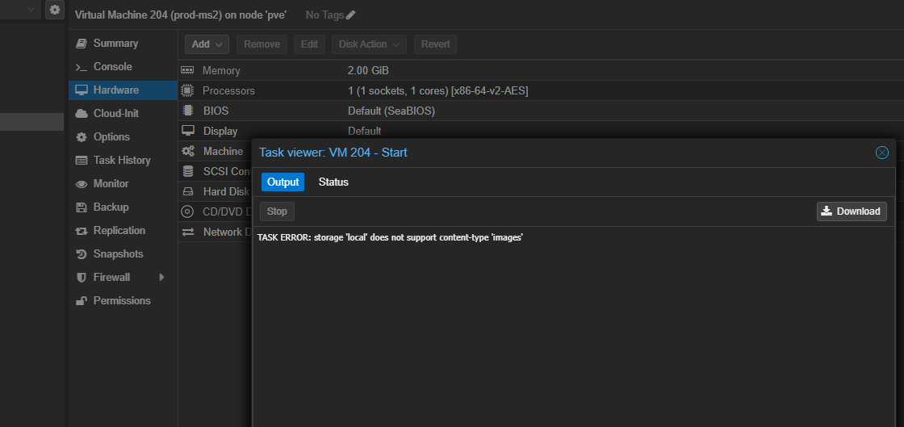
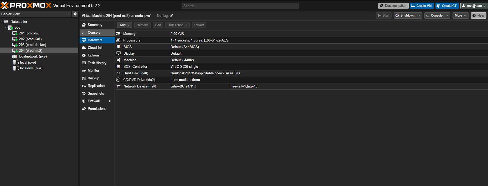
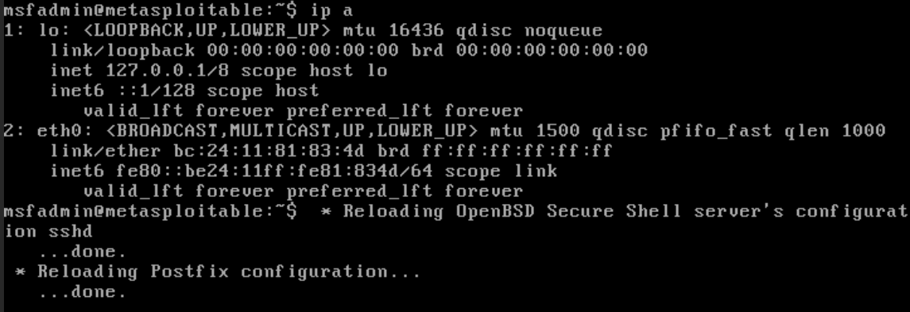
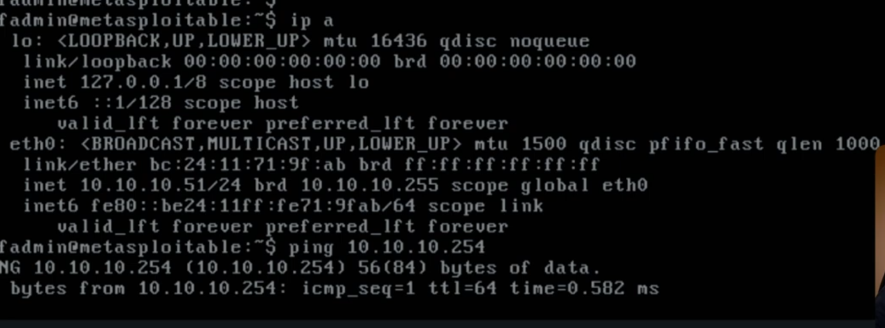
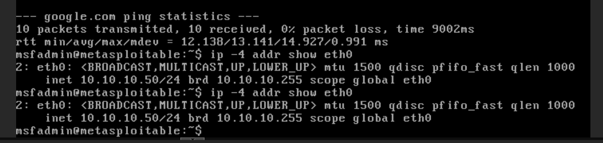

# 01 — Metasploitable2 Deployment on Proxmox

## Objective

Deploy the intentionally vulnerable **Metasploitable2** Linux virtual machine in Proxmox as a controlled practice target, using the existing VLAN 10 lab network.

## Verified deployment

| Property | Value |
|---|---|
| Proxmox VM ID / name | `204` / `prod-ms2` |
| Memory | 2 GiB |
| CPU | 1 socket, 1 core |
| BIOS | SeaBIOS |
| Virtual hard disk | `Metasploitable.qcow2` |
| Disk allocation shown | 32G (virtual size shown by Proxmox) |
| Attached disk controller | IDE (`ide0`) |
| Virtual network | VirtIO on `vmbr1`, tag `10` |
| Proxmox NIC firewall switch | Enabled; policy effectiveness not verified |
| Guest IPv4 | `10.10.10.50/24` on `eth0` |

## Disk preparation and import

The source came as a VMware-compatible ZIP archive. On the Proxmox host, I installed an extraction utility and converted the included VMDK into Proxmox-compatible QCOW2 format:

```bash
apt install unzip -y
unzip metasploitable-linux-2.0.0.zip
cd Metasploitable2-Linux
qemu-img convert -f vmdk Metasploitable.vmdk -O qcow2 Metasploitable.qcow2
```

I worked in Proxmox's `/var/lib/vz/images/204/` directory and used the converted disk as the VM's primary hard disk. The virtual hard disk appears under **`ide0`** in the final VM configuration, so its boot order must select the attached disk device.

**Problem encountered:** Proxmox initially refused to start VM 204 with the error `storage 'local' does not support content-type 'images'`. The storage content-type configuration had to be addressed before the disk could be used. A later screenshot verifies the VM booted successfully.







## Network validation

The guest initially displayed an `eth0` adapter without an IPv4 address. Later, it obtained the correct VLAN 10 IPv4 address and was able to ping its VLAN 10 gateway. I also encountered an application access issue after trying the tutorial's example address `10.10.10.51`; the actual guest address was **`10.10.10.50`**.

```text
eth0: UP
IPv4: 10.10.10.50/24
Broadcast: 10.10.10.255
Gateway checked by ping: 10.10.10.254
```

The broadcast address (`10.10.10.255`) is **not** the firewall gateway. The guest has a different host address from the tutorial, which is normal in a dynamically addressed environment.







## Outstanding security finding

The guest also successfully pinged `google.com`, demonstrating that **outbound internet access was available** during this lab stage. Because Metasploitable2 is intentionally vulnerable, it should be isolated from unrestricted outbound access and from unrelated networks. This remains on the security validation checklist: [05 — Security Review](05-Security-Review.md).

## Evidence summary

A screenshot of the guest console establishes that the VM is running and has IPv4 connectivity. It does not by itself prove that network isolation or firewall restrictions have been enforced.
