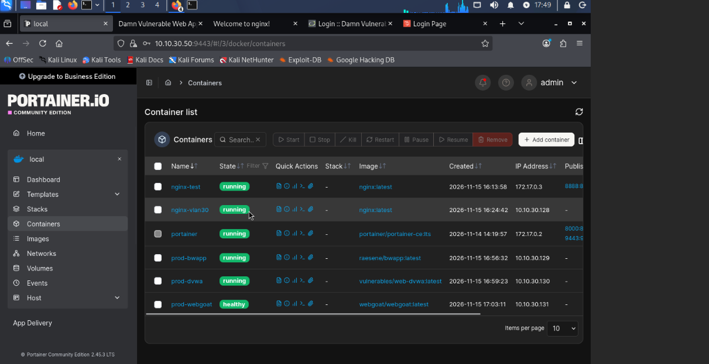
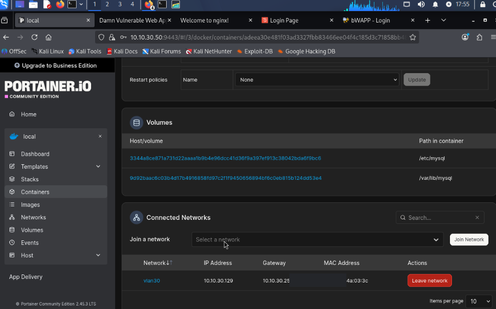
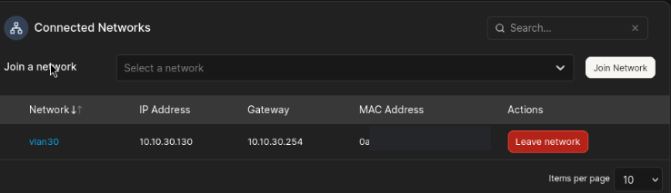
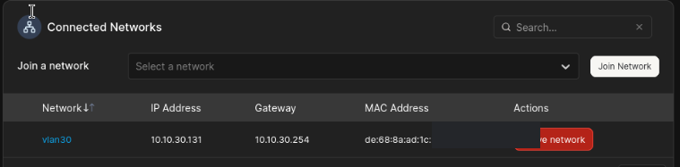
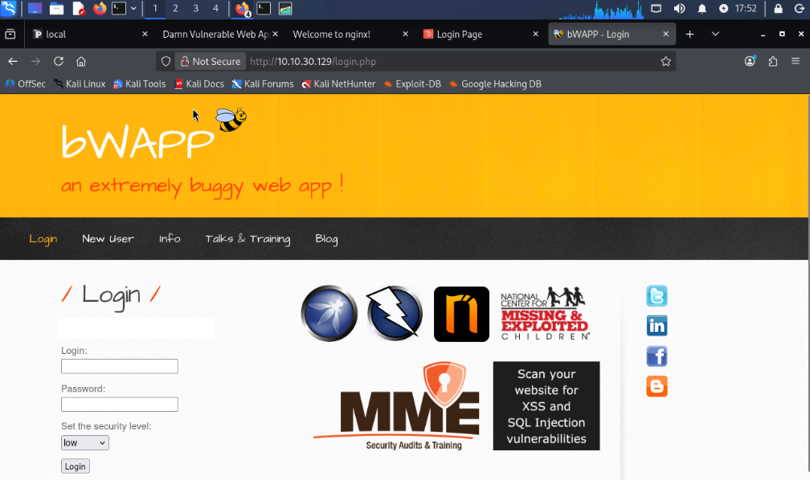
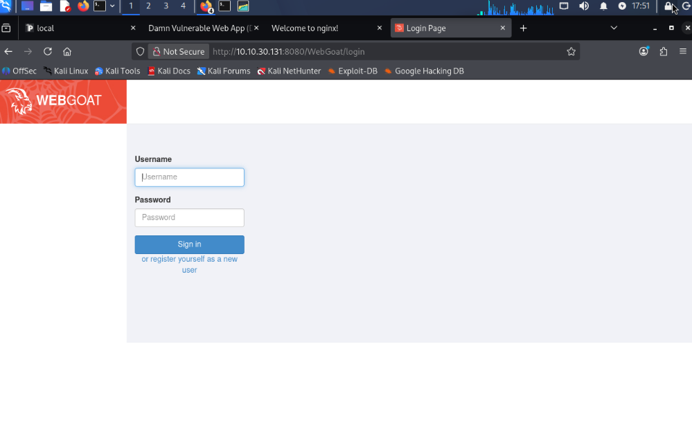
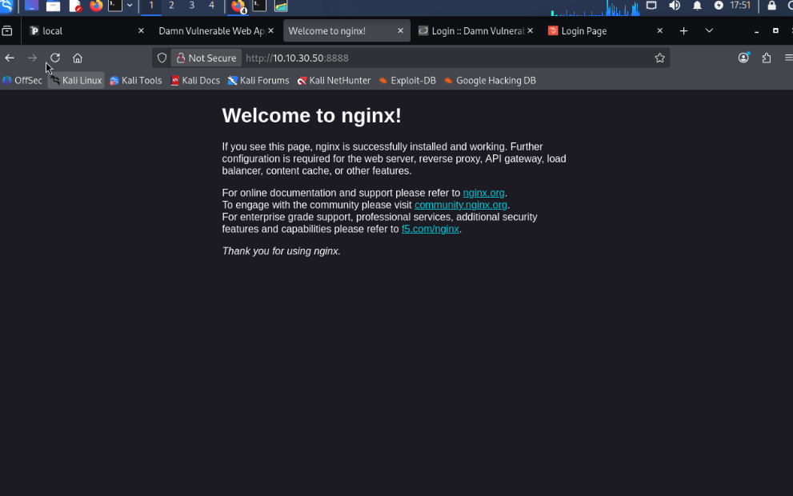
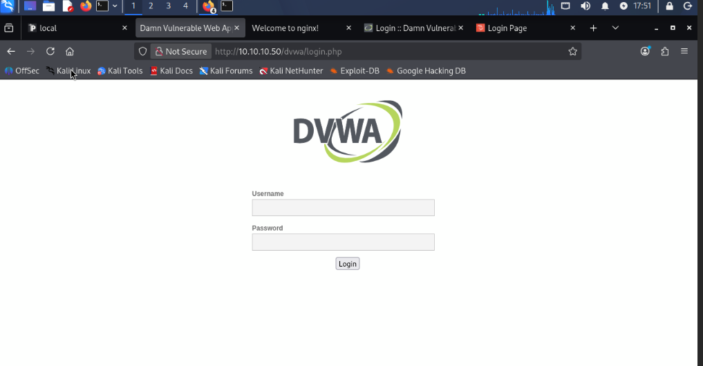

# 02 — Docker-Based Vulnerable Web Applications

## Objective

Deploy and inspect deliberately vulnerable web applications for authorized training and verify that the running containers are associated with the intended Docker network.

## Container inventory

The Portainer **Containers** view showed six running containers after WebGoat's health-check issue was corrected.

| Container | Image shown in Portainer | IP | Status in screenshot | Notes |
|---|---|---|---|---|
| `nginx-test` | `nginx:latest` | `172.17.0.3` | running | Docker default bridge test |
| `nginx-vlan30` | `nginx:latest` | `10.10.30.128` | running | Dedicated VLAN 30 test container |
| `portainer` | `portainer/portainer-ce:lts` | `172.17.0.2` | running | Container management |
| `prod-bwapp` | `raesene/bwapp:latest` | `10.10.30.129` | running | Intentionally vulnerable training app |
| `prod-dvwa` | `vulnerables/web-dvwa:latest` | `10.10.30.130` | running | Separate DVWA container; login access not independently shown |
| `prod-webgoat` | `webgoat/webgoat:latest` | `10.10.30.131` | **healthy** | Health check fixed as a temporary in-container test |

## VLAN 30 membership

Portainer's **Connected Networks** sections verified the following Docker network details:

| Application | Network | Address | Gateway |
|---|---|---|---|
| bWAPP | `vlan30` | `10.10.30.129` | `10.10.30.254` |
| DVWA | `vlan30` | `10.10.30.130` | `10.10.30.254` |
| WebGoat | `vlan30` | `10.10.30.131` | `10.10.30.254` |

These screenshots verify **Docker network membership and configured IP settings**, but not the effectiveness of firewall isolation. The Proxmox/pfSense routing and access control policies must be validated independently.

## Browser checks

### bWAPP

Successfully opened the bWAPP login form at **`http://10.10.30.129/login.php`** from the Kali lab desktop. Creating an application account and completing training exercises were not part of this screenshot collection.

### WebGoat

Successfully opened **`http://10.10.30.131:8080/WebGoat/login`** after resolving the app's health-check problem and correcting an HTTP/HTTPS URL mix-up. This confirms the login page loads; a user account was not yet verified.

### Nginx

A test Nginx page loaded at **`http://10.10.30.50:8888`**. This is a browser-level check of the test web server.

### DVWA — important distinction

The screenshot of the DVWA login page was captured at **`http://10.10.10.50/dvwa/login.php`**, which is the **Metasploitable2 guest in VLAN 10**. It is **not** evidence that the separate `prod-dvwa` container at `10.10.30.130` has a working login route. Portainer does confirm that the container was running and connected to `vlan30`.

## Observations

- The intentionally vulnerable apps were deployed on the lab's VLAN 30 Docker network, except the separate DVWA page within Metasploitable2.
- App login pages can be tested for reachability without creating user accounts or performing attacks.
- Docker shows application status, but container health and functional access should be tested separately.
- Exposing the services on a dedicated VLAN is **not equivalent to preventing access to or from other networks**.

For the WebGoat root cause and repair, see [03 — WebGoat Health Check](03-WebGoat-Healthcheck.md).
