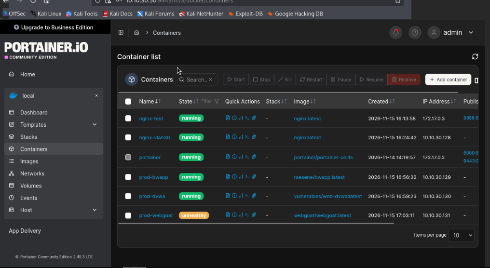
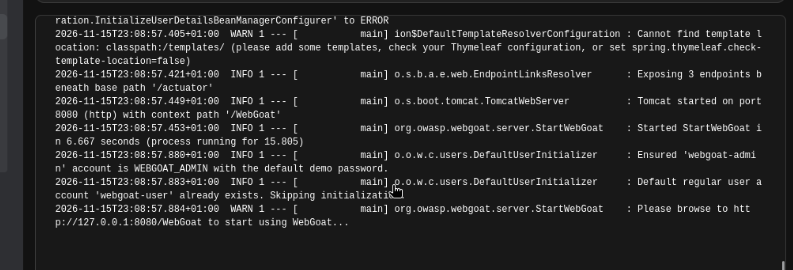
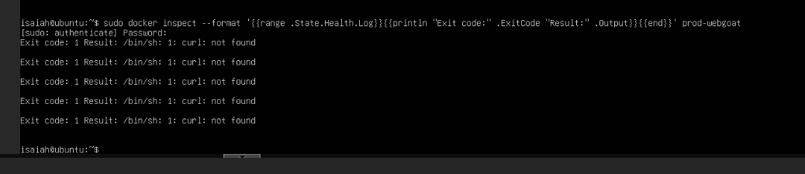
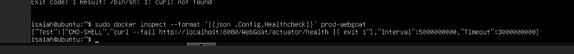
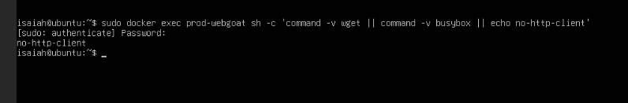
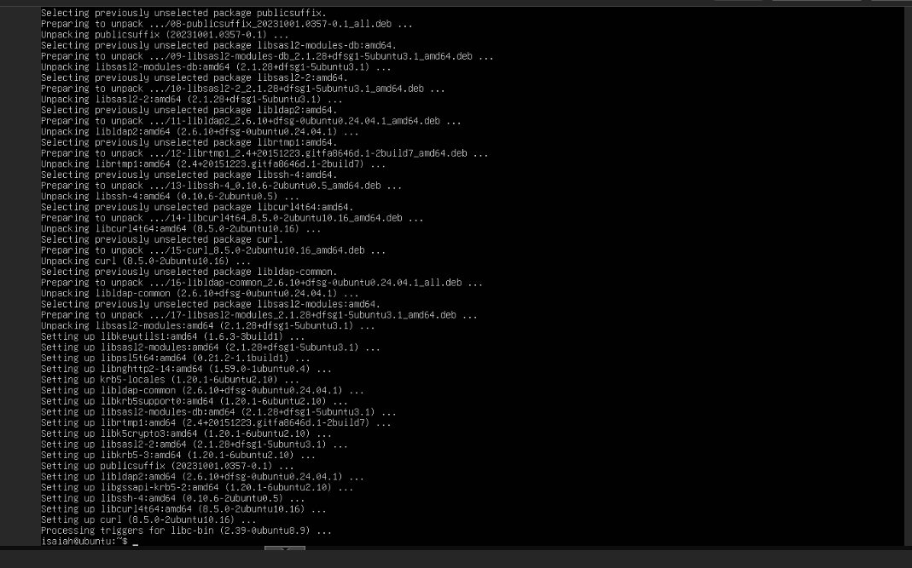
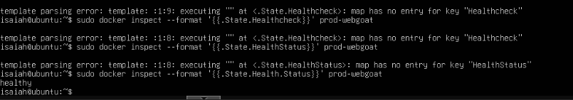
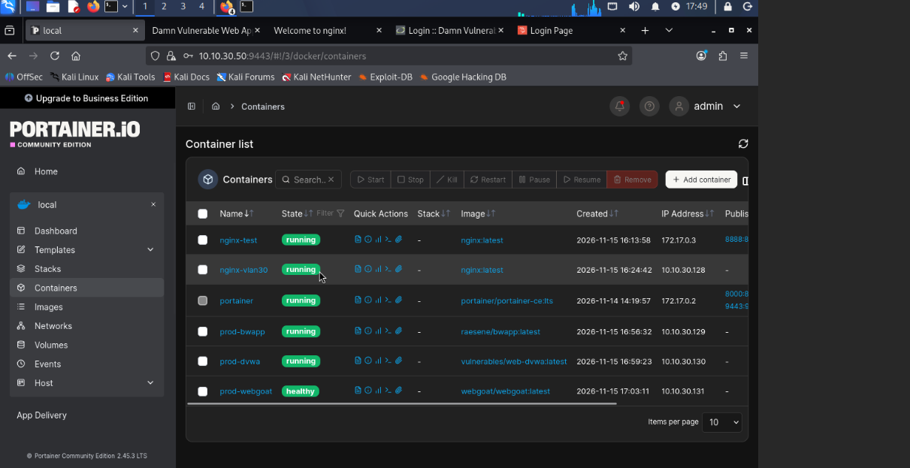
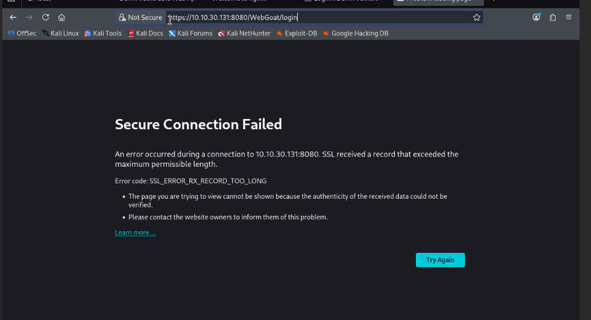
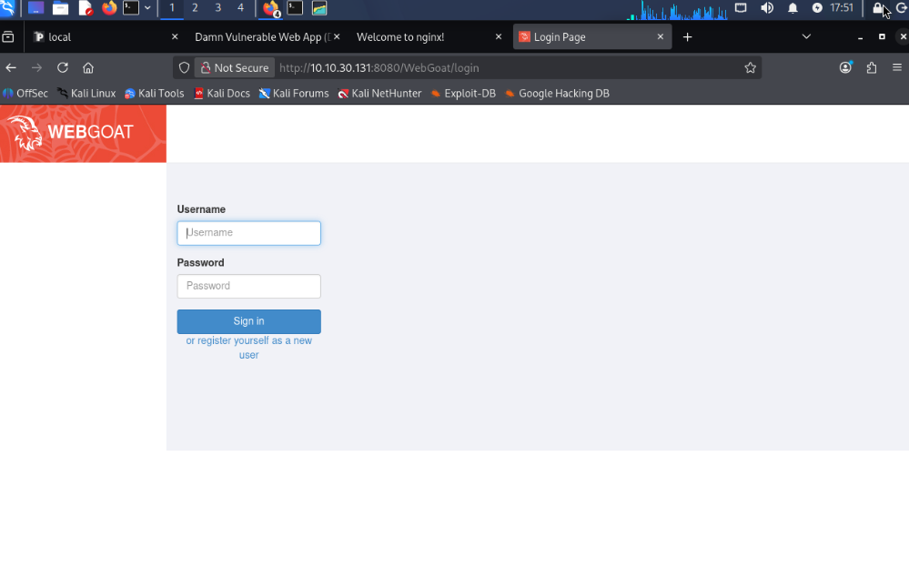

# 03 — WebGoat Docker Health Check: Investigation and Repair

## Problem

After deploying `prod-webgoat` with the `webgoat/webgoat:latest` image, Portainer marked the container **`unhealthy`**, even though its startup log showed WebGoat and Tomcat had started.



## Investigation

First, I reviewed the application logs. They showed Tomcat on HTTP port 8080, WebGoat startup, and initialization messages. This suggested that the application's core process was running, so I inspected the actual Docker health-check results instead of immediately recreating the container.

```bash
sudo docker inspect --format '{{range .State.Health.Log}}{{println "Exit code:" .ExitCode "Result:" .Output}}{{end}}' prod-webgoat
```

The result repeatedly included:

```text
Exit code: 1 Result: /bin/sh: 1: curl: not found
```

The configured test attempted to reach:

```bash
curl --fail http://localhost:8080/WebGoat/actuator/health || exit 1
```

The WebGoat image lacked `curl`, and checks for `wget` and `busybox` did not find an alternative HTTP client. The guest inside the container was identified as **Ubuntu 24.04.5 LTS**.









## Corrective action performed

As a **temporary diagnostic fix**, I installed `curl` inside the existing running container as root:

```bash
sudo docker exec -u 0 prod-webgoat sh -c 'apt-get update && apt-get install -y curl'
```

The package installation succeeded. I then verified the Docker health state using the correct inspect field:

```bash
sudo docker inspect --format '{{.State.Health.Status}}' prod-webgoat
```

The output was:

```text
healthy
```





The Portainer container list subsequently displayed WebGoat as **Healthy**.



## Browser protocol issue

I initially tried to open WebGoat at `https://10.10.30.131:8080/...`. Firefox returned `SSL_ERROR_RX_RECORD_TOO_LONG` because the application was serving **HTTP** on port 8080. Switching to **`http://10.10.30.131:8080/WebGoat`** allowed the login page to load.





## What is and is not fixed

**Verified:** WebGoat started; Docker reported `healthy`; the login page loaded over HTTP in the lab.

**Not yet permanent:** Installing `curl` interactively modifies the existing container's writable filesystem, but **recreating that container from its original image would lose the change**. A later task is to build and test a custom image containing the required client, or use a health check supported by tools already in the image. The permanent solution has **not** yet been deployed or verified.

## Skills demonstrated

Docker logs, container inspection, diagnosing health checks, root versus nonroot container users, Linux package installation, and correct HTTP/HTTPS service access.
