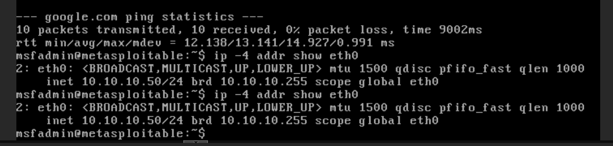
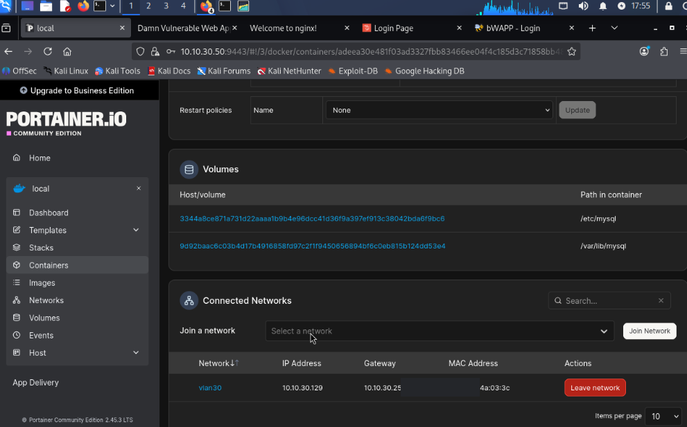
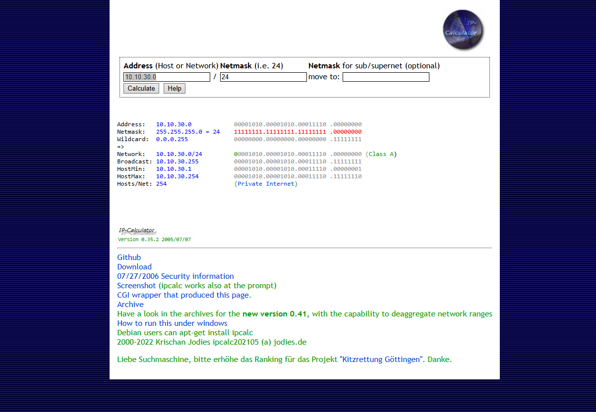
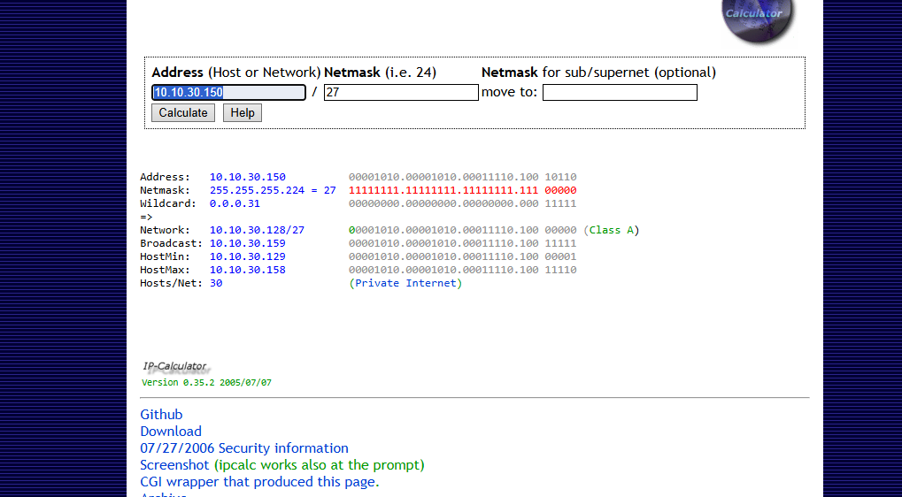

# 04 — VLAN Networking and IPv4 Subnetting

## Why this matters

A security lab needs clear addressing, intended network boundaries, and evidence that systems can reach services **only where access is allowed**. During Video 2, I verified the container IP configuration and practiced interpreting private IPv4 networks.

## Verified lab network assignments

| Network | System | Address | Gateway evidence |
|---|---|---|---|
| VLAN 10 | Metasploitable2 (`prod-ms2`) | `10.10.10.50/24` | Successful ping to `10.10.10.254` |
| VLAN 30 | `nginx-vlan30` | `10.10.30.128` | Container list shows VLAN 30 address |
| VLAN 30 | `prod-bwapp` | `10.10.30.129` | Portainer shows `10.10.30.254` |
| VLAN 30 | `prod-dvwa` | `10.10.30.130` | Portainer shows `10.10.30.254` |
| VLAN 30 | `prod-webgoat` | `10.10.30.131` | Portainer shows `10.10.30.254` |

The VLAN 30 Docker network membership was verified in Portainer, while the Proxmox Metasploitable2 NIC had VLAN tag 10 on the lab bridge `vmbr1`.

## Subnet calculation 1: `10.10.30.0/24`

| Property | Value |
|---|---|
| Network | `10.10.30.0/24` |
| Mask | `255.255.255.0` |
| Network ID | `10.10.30.0` |
| Broadcast | `10.10.30.255` |
| First usable | `10.10.30.1` |
| Last usable | `10.10.30.254` |
| Usable host addresses | 254 |

## Subnet calculation 2: `10.10.30.150/27`

| Property | Value |
|---|---|
| Host address examined | `10.10.30.150` |
| Mask | `255.255.255.224` |
| Network ID | `10.10.30.128/27` |
| Broadcast | `10.10.30.159` |
| First usable | `10.10.30.129` |
| Last usable | `10.10.30.158` |
| Usable host addresses | 30 |

**Important:** The `/27` calculation is a **subnetting exercise**. The screenshot does *not* demonstrate that the live VLAN 30 Docker network was actually changed to `/27`. Notably, the configured VLAN 30 gateway `10.10.30.254` is **outside** `10.10.30.128/27`. The live network mask and routing configuration would need to be inspected before claiming a `/27` design is in use.

## Security follow-up

Connecting containers to `vlan30` provides an address and a logical network association. It does **not** by itself prove inter-VLAN segmentation is enforced. Earlier pfSense screenshots showed broad IPv4 allow rules and a vulnerable Metasploitable2 instance reaching the internet.

See [05 — Security Review](05-Security-Review.md) for actions still requiring validation.
