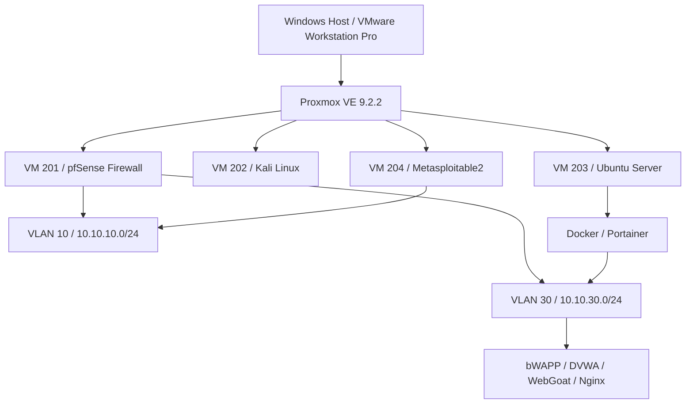
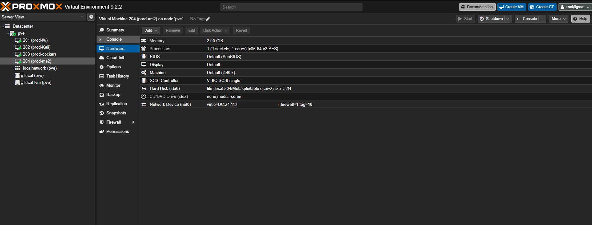
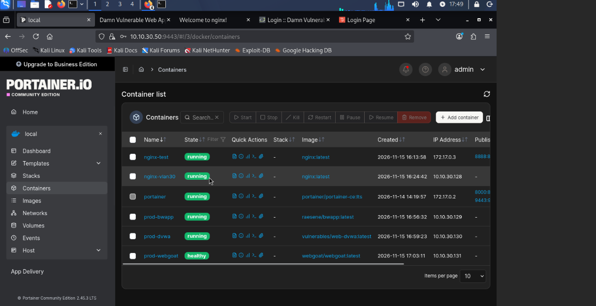

# Video 2 — Vulnerable Lab Environment & Network Validation

> **Project:** Ultimate Cybersecurity Home Lab  
> **Stage:** Video 2 — Metasploitable2, Docker-based training applications, and VLAN 30  
> **Status:** Initial deployment and application access verified; network isolation requires additional testing

## Overview

During this stage, I expanded my virtual cybersecurity lab with **Metasploitable2** and several purpose-built training web applications. I used **Proxmox VE, pfSense, Ubuntu Server, Docker, and Portainer** to manage systems on separate lab networks. I also practiced subnetting, investigated startup and networking issues, and repaired a failing Docker health check.

This folder records my **own configuration and troubleshooting results**. It is not a general installation tutorial, and it does not claim that the intentionally vulnerable systems are fully isolated or hardened.

## Architecture at a glance

**Architecture note:** This shows the lab's logical assignments, not proof of enforced traffic restrictions. In particular, connectivity from Metasploitable2 to the public internet was observed. See the [security review](05-Security-Review.md).

## Systems and services

| Component | Verified configuration | Evidence |
|---|---|---|
| Metasploitable2 | VM `204` (`prod-ms2`), 1 vCPU, 2 GiB RAM, 32G QCOW2, `vmbr1` with VLAN tag 10 | [VM hardware](screenshots/metasploitable/03-proxmox-vm-hardware.png) |
| Metasploitable2 network | `eth0` at `10.10.10.50/24`; VLAN 10 gateway `10.10.10.254` responded to ping | [Console](screenshots/metasploitable/04-console-ip-and-connectivity.png) |
| Nginx test service | `nginx-vlan30` at `10.10.30.128`; separate `nginx-test` container also running | [Portainer](screenshots/docker-apps/02-portainer-containers-healthy.png) |
| bWAPP | `prod-bwapp` on Docker `vlan30` network, `10.10.30.129`, gateway `10.10.30.254`; login loads | [Login](screenshots/docker-apps/06-bwapp-login.png) |
| DVWA container | `prod-dvwa` on Docker `vlan30`, `10.10.30.130`; container running | [Network](screenshots/networking/04-dvwa-vlan30.png) |
| WebGoat | `prod-webgoat` on Docker `vlan30`, `10.10.30.131`; health check recovered to `healthy` | [Portainer](screenshots/docker-apps/02-portainer-containers-healthy.png) |

**Important DVWA distinction:** The [DVWA login screenshot](screenshots/docker-apps/03-dvwa-login-metasploitable2.png) is at **`10.10.10.50`**, the Metasploitable2 VM. It does **not** independently prove the separate DVWA Docker container at `10.10.30.130` serves its login page.

## Key accomplishments

- Imported a VMware VMDK image into Proxmox by converting it to QCOW2 and configured VM 204.
- Diagnosed an unsupported Proxmox storage content-type error and later verified the virtual machine operating system was running.
- Verified Metasploitable2 IPv4 addressing and connectivity to its VLAN 10 gateway.
- Deployed Nginx, bWAPP, DVWA, and WebGoat containers with Portainer and inspected VLAN 30 membership.
- Traced WebGoat's `unhealthy` state to a missing `curl` binary in its image, tested a fix, and confirmed Docker reported `healthy`.
- Verified login-page reachability for bWAPP and WebGoat, plus a working Nginx page.
- Practiced `/24` and `/27` IPv4 subnet calculations.

## Documentation

| Section | Contents |
|---|---|
| [01 — Metasploitable2 Deployment](01-Metasploitable2.md) | Image import, VM settings, disk conversion, boot and connectivity troubleshooting |
| [02 — Vulnerable Web Applications](02-Web-Applications.md) | Portainer inventory, application checks, VLAN 30 container assignments |
| [03 — WebGoat Health Check Investigation](03-WebGoat-Healthcheck.md) | Symptoms, root cause, corrective test, outcome and permanent-fix plan |
| [04 — Networking & Subnetting](04-Networking-and-Subnetting.md) | VLANs, connected networks and IP calculation exercises |
| [05 — Security Review](05-Security-Review.md) | Findings still to address before treating this as an isolated test environment |
| [Screenshot Index](SCREENSHOT-INDEX.md) | Organized visual evidence, filenames and descriptions |

## Evidence highlights

**Metasploitable2 virtual machine configuration**

**Docker services after resolving the WebGoat health check**

## Skills practiced

**Virtualization:** Proxmox virtual machines, VMware disk import, QCOW2, storage configuration.  
**Networking:** VLAN tagging, IPv4 subnetting, gateway checks, Docker network inspection.  
**Linux:** SSH terminal administration, package installation, network diagnostics.  
**Containers:** Docker image troubleshooting, Portainer, health-check diagnosis, service logs.  
**Security:** Safe lab design, recognition of intentional vulnerabilities and identification of isolation gaps.

## Learning resource

[Tech with Gerard — Ultimate Cybersecurity Lab (Video 2)](https://www.youtube.com/watch?v=Gm_olWLLCqo&list=PL3ljjyal211AbTqlxSo6CGBiVqsXw8wrp&index=3)

## Scope & disclaimer

This project is intended solely for testing in systems I own or am authorized to assess. **Metasploitable2, DVWA, bWAPP, and WebGoat are intentionally vulnerable**, and their presence alone does not constitute a secure or production-ready environment. I will continue to verify and improve network isolation in later lab stages.
