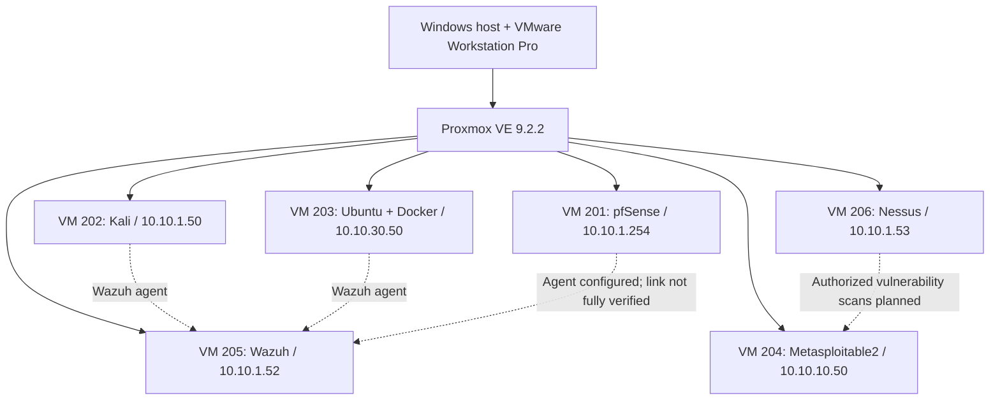
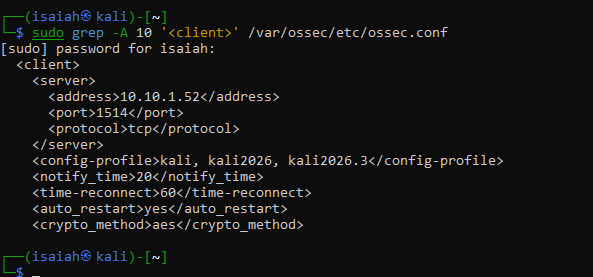
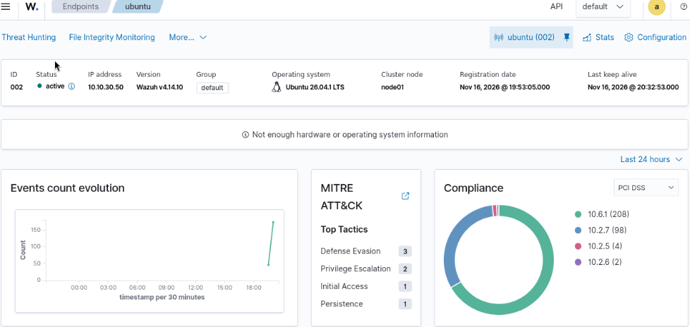
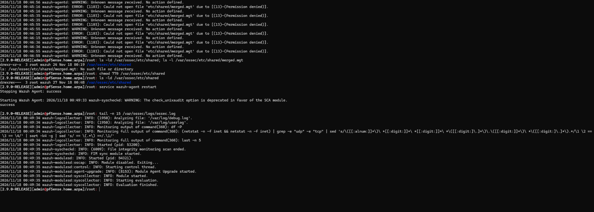
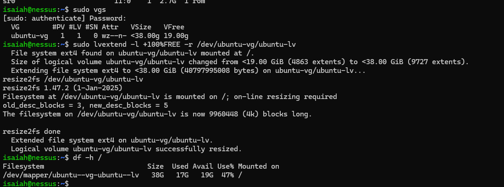

# Video 3 — Wazuh SIEM, Endpoint Monitoring, pfSense Logging & Nessus

> **Project:** Ultimate Cybersecurity Home Lab  
> **Source:** [Tech with Gerard — Building the Ultimate Cybersecurity Lab, Episode 3](https://www.youtube.com/watch?v=ytWZ6OrFEQE)  
> **Lab work documented:** November 16–18, 2026  
> **Status:** Wazuh dashboard and Kali/Ubuntu agents validated; pfSense agent configuration and recovery documented; Nessus installed and plugin storage issue repaired. **Final pfSense connection and an actual Nessus vulnerability scan are not yet verified.**

## Project overview

In this stage I deployed **Wazuh** for security monitoring, connected my Kali Linux and Ubuntu Docker hosts as agents, investigated firewall telemetry from **pfSense**, and installed **Nessus Essentials** for vulnerability assessment. I documented the installation alongside significant real-world troubleshooting, including Wazuh API timeouts, agent configuration and file permissions, and disk exhaustion during Nessus plugin loading.

This write-up records **my own lab work and verification** rather than claiming every step in the linked video was completed or that this environment is production-ready.

## Architecture

> **Network caution:** This diagram illustrates logical connections, not proof of VLAN isolation. Previous testing showed an intentionally vulnerable lab machine reaching the public internet. Firewall segmentation still needs verification before active scanning or attack simulations.

## Systems at a glance

| VM | Role | Address | Evidence-based status |
|---|---|---|---|
| 201 | pfSense firewall / log source | `10.10.1.254` | Wazuh agent service restarted; last *Active* state not independently confirmed |
| 202 | Kali Linux endpoint | `10.10.1.50` | Wazuh Agent 001 verified Active |
| 203 | Ubuntu + Docker | `10.10.30.50` | Wazuh Agent 002 verified Active; Docker listener started |
| 204 | Metasploitable2 training target | `10.10.10.50` | Deployed in prior stage; no Nessus scan result yet |
| 205 | Wazuh SIEM/XDR | `10.10.1.52` | Dashboard and monitoring usable after service troubleshooting |
| 206 | Nessus Essentials | `10.10.1.53` | UI accessible; plugins rebuilt; disk fixed; first scan pending |

## What I accomplished

- Deployed and accessed Wazuh with its manager, dashboard, and index components.
- Registered Kali and Ubuntu as **active Wazuh agents**; verified central monitoring for Ubuntu (238 alerts in a captured 24-hour view).
- Corrected the Ubuntu agent's manager address from `10.0.0.2` to `10.10.1.52`.
- Enabled Wazuh's `docker-listener` module and confirmed startup in agent logs; validated Docker independently with `sudo docker run --rm hello-world`.
- Configured pfSense log collection and a custom rule in Wazuh; investigated Wazuh agent permission errors and repaired `/var/ossec/etc/shared` group write access.
- Diagnosed a Wazuh Manager service timeout and saved a systemd override to allow a longer startup window.
- Installed and activated Nessus Essentials on VM 206, repaired an unsuccessful plugin load, and expanded its full Ubuntu root filesystem **from 19 GB to 38 GB**, freeing approximately **19 GB** without resizing the virtual disk in Proxmox.

## Documentation files

| File | Focus |
|---|---|
| [01-Wazuh-Deployment.md](01-Wazuh-Deployment.md) | Wazuh architecture, manager startup and API recovery |
| [02-Endpoint-and-Docker-Monitoring.md](02-Endpoint-and-Docker-Monitoring.md) | Kali/Ubuntu agents and Docker listener validation |
| [03-pfSense-Firewall-Integration.md](03-pfSense-Firewall-Integration.md) | pfSense logs, custom rule and agent troubleshooting |
| [04-Nessus-Deployment-and-Storage-Fix.md](04-Nessus-Deployment-and-Storage-Fix.md) | Nessus setup, plugin rebuild and LVM filesystem expansion |
| [05-Validation-and-Security-Review.md](05-Validation-and-Security-Review.md) | Confirmed vs unconfirmed functionality, safety checklist |
| [SCREENSHOT-INDEX.md](SCREENSHOT-INDEX.md) | Screenshot evidence organized by subject |
| [EVIDENCE-MANIFEST.csv](EVIDENCE-MANIFEST.csv) | Source filenames, evidence descriptions and image paths |

## Evidence highlights

**Kali agent points to the Wazuh Manager**

**Ubuntu Agent 002 is active in Wazuh**

**pfSense agent recovered from a permissions error, then restarted**

**Nessus root filesystem expansion succeeded**

## Skills demonstrated

**SIEM and endpoint telemetry:** Wazuh Manager, Linux agents, syslog collection, custom rules, service diagnostics.  
**Infrastructure:** Proxmox, pfSense, VLAN addressing, Linux networking, SSH jump hosts.  
**Container monitoring:** Docker, Portainer, Docker event listener and log inspection.  
**Vulnerability management:** Nessus installation and plugin troubleshooting.  
**Linux operations:** `systemctl`, `journalctl`, `tail`, package troubleshooting, permissions, LVM and ext4 online expansion.

## Reference

- [Episode 3 — Tech with Gerard](https://www.youtube.com/watch?v=ytWZ6OrFEQE); video sections: Wazuh VM (0:35), Kali agent (5:01), Docker agent (7:04), pfSense agent (11:20), Nessus (19:58).
- [Original tutorial GitHub project](https://github.com/gerardobrien/ultimate-cybersecurity-lab).

The tutorial dates from 2024. My 2026 installation used different software releases, so I validated commands against the versions actually available in my lab. This repository is for educational use on systems I own or am authorized to test.
