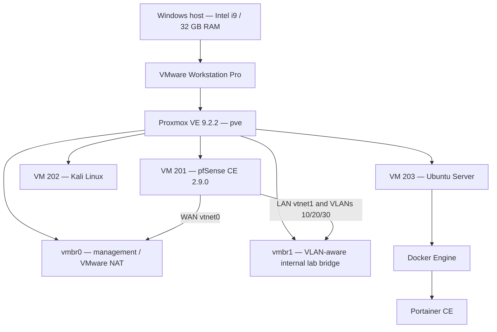

# Episode 1 — Cybersecurity Lab Infrastructure

**Project:** Ultimate Cybersecurity Home Lab  
**Guide followed:** [Building the Ultimate Cybersecurity Lab, Episode 1 — Tech with Gerard](https://www.youtube.com/watch?v=XIvn0ZDSmKA&list=PL3ljjyal211AbTqlxSo6CGBiVqsXw8wrp)  
**Build platform:** Windows host → VMware Workstation Pro → nested Proxmox VE  
**Documentation status:** Initial build evidenced; further security validation pending

## What I built

I built a multi-VM cybersecurity lab on a Windows desktop. VMware Workstation Pro hosts a Proxmox VE hypervisor. Proxmox runs a virtual pfSense firewall, a Kali Linux VM, and an Ubuntu Server VM running Docker Engine and Portainer. The lab includes a dedicated internal virtual bridge and three configured VLAN interfaces for continued network security exercises.

## Documentation sections

| Section | What is documented | Evidence |
|---|---|---|
| [01 — Network infrastructure](01-Network-Setup/README.md) | VMware, Proxmox, VM inventory, virtual bridges, repository troubleshooting | 6 screenshots |
| [02 — pfSense and VLANs](02-pfSense-Firewall/README.md) | WAN/LAN, VLAN 10/20/30, interface assignments, LAN/VLAN firewall rules | 7 screenshots |
| [03 — Kali Linux](03-Kali-Linux/README.md) | Kali version, initial system and LAN interface | 2 screenshots |
| [04 — Ubuntu Server](04-Ubuntu-Server/README.md) | Ubuntu LTS installation and observed IP addresses | 2 screenshots |
| [05 — Docker and Portainer](05-Docker-Portainer/README.md) | Running container, published ports, Portainer environment dashboard | 2 screenshots |

## Architecture (logical overview)

> The arrows above represent the documented architecture and intended lab connectivity. Per-VM bridge attachments, VLAN tags, and traffic-isolation outcomes must be verified before treating this as a complete network topology diagram.

## Security validation not yet demonstrated

- The VLAN 10, 20 and 30 interfaces have allow-to-any IPv4 rules; **isolation is not verified or enforced by those rules**.
- A former pfSense screen showed a default-password warning; confirm the administrator password has been replaced before publishing the lab.
- Confirm the Proxmox `vmbr1` address displayed as `10.10.1.0/24` is not incorrectly configured as a host IP.
- No vulnerability scans, IDS/SIEM deployment, or network attack simulations are claimed in this episode.

**Note:** This folder is Episode 1 documentation. The repository's existing main `README.md` is deliberately left unchanged until the full video series is finished.
